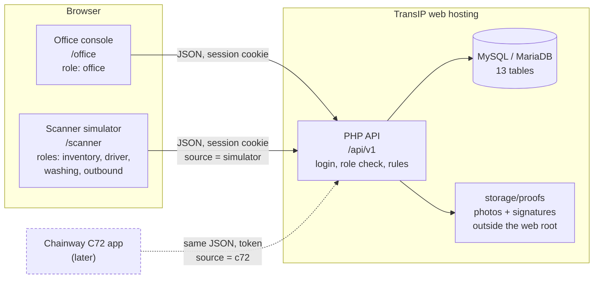
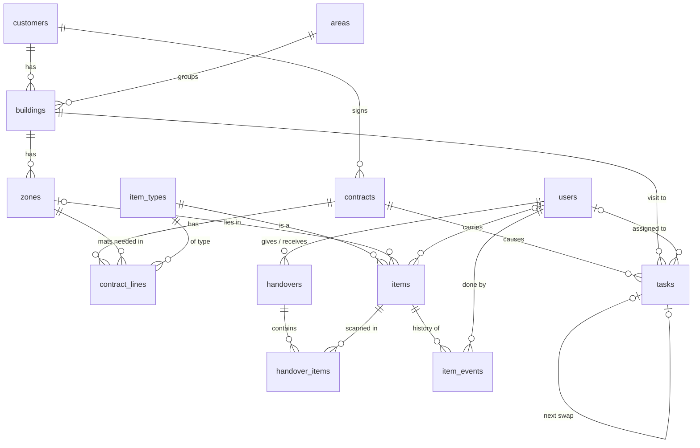

# Architecture

Version: 0.4.2

System design for the first build of the Proti mat tracking POC. It follows [POC.md](POC.md), [FEATURES.md](FEATURES.md) and [FLOW.md](FLOW.md). The database is in [db/schema.sql](db/schema.sql), the mock data in [db/seed.sql](db/seed.sql).

## What this build is

- **Web app only.** No Android app and no Chainway C72 yet.
- **The handheld is simulated.** A scanner screen inside the web app plays the role of the C72. The user picks mats from a list instead of pulling the trigger.
- **Mock mats only.** 40 made-up mats with made-up tag ids. No real product is tagged.
- **Every role logs in on the web.** Office staff get the office console. The other four roles get the scanner screens they will later have on the C72.

The rule that keeps this honest: **the simulator sends exactly what the C72 will send.** It calls the same API with the same JSON. When the real handheld arrives, only the source of the tag ids changes. The backend, the database and the office console stay as they are.

## Overview



| Part | Built with | Job |
|---|---|---|
| Frontend | React 19 with Vite and Tailwind, built to static files | One app, served by Laravel on the same address as the API. After login the role decides what opens: the office console for the office, the handheld screens for everyone else. The office console can also show the handhelds of all roles side by side, each with its own token login. |
| Backend | Laravel 13 on PHP 8.3+, JSON API | Login, role checks, every business rule, every status change. The frontend never decides whether a mat may move. Laravel does the login session, the forgery check, input validation and file storage; the rules are this project's own code. |
| Database | MySQL 8.0.16+ or MariaDB 10.4+ | Current state of every mat plus its full history. |
| File storage | Folder on the hosting disk | Proof photos and signatures. |

## Hosting at TransIP

Designed for a TransIP web hosting package: PHP, one MySQL/MariaDB database, a disk, cron jobs. No long-running processes and no websockets, so screens refresh by asking the API again (polling), not by push.

```
db/                  schema.sql and seed.sql      (not reachable from the web)
site/                the Laravel application
  app/               backend code                 (not reachable from the web)
  routes/api.php     every API route and who may call it
  routes/web.php     every other address gives the one page of the web app
  resources/js/      the web app's source (React)  (not reachable from the web)
  storage/           proofs, sessions, logs       (not reachable from the web)
  .env               database password, settings  (not reachable from the web, never in git)
  public/            web root: the site's DocumentRoot points here
    index.php        Laravel's entry point, serves /api/v1/* and the web app's page
    build/           the built web app (npm run build), uploaded, not in git
    .htaccess        HTTPS only; everything that is not a file goes to index.php
```

The web root must point at `site/public`. It needs SSH on the hosting, for `composer` and `php artisan`. The web app is built with `npm run build` into `site/public/build` and uploaded; the hosting needs no Node.

Settings the backend reads from `.env`:

| Name | Meaning |
|---|---|
| `APP_KEY` | Secret key for cookies and sessions. Made once with `php artisan key:generate`. |
| `APP_ENV` | `production` on the server |
| `APP_DEBUG` | `false` on the server: error details stay in the log |
| `APP_URL` | The address of the site, with `https://`. The login cookie only works for the web app at this address. |
| `DB_HOST`, `DB_PORT`, `DB_DATABASE`, `DB_USERNAME`, `DB_PASSWORD` | Database connection, from the TransIP control panel |
| `SCANNER_SIMULATOR` | `true` while the handheld is simulated. `false` switches the simulator and its helper endpoint off. |
| `SESSION_SECURE_COOKIE` | `true` on the server: the login cookie travels over HTTPS only |

Nothing that differs per machine is written in the code. `site/.env.example` lists every setting with a comment. After a change to `.env` on the server, run `php artisan config:cache`.

There is no database on the development machine. The tests use a second database at TransIP, named in `site/.env.testing`, and rebuild it on every run. No database at TransIP can be reached from outside the hosting. The development machine reaches the test database through an SSH tunnel.

On every database connection the backend runs `SET time_zone = '+00:00'` and switches strict SQL mode on. Without strict mode MySQL silently accepts an unknown status.

Times are stored and sent in UTC, not in Dutch time. Dutch time repeats one hour every autumn and skips one every spring, so two scans in that night could not be put in order. A named time zone also needs time zone tables that a shared database often does not have. The screens show every time in Dutch time. Calendar days (due dates, wash dates) are Dutch calendar days.

Laravel adds two tables of its own next to the 13 of `db/schema.sql`: `migrations` (which set-up steps ran) and `personal_access_tokens` (one row per logged-in handheld).

Still to check in the TransIP control panel: the exact database engine and version (`SELECT VERSION();` in phpMyAdmin), the PHP version, and that HTTPS is on. The schema was loaded and tested on MariaDB 10.11 and MySQL 8.0, so either works.

## Users and what they see

One login per person, one role per login. The role is stored in `users.role`.

| | Office | Inventory manager | Delivery guy | Washing house manager | Outbound |
|---|---|---|---|---|---|
| Opens after login | Office console | Scanner | Scanner | Scanner | Scanner |
| Customers, buildings, zones, areas | Add and edit | No | Only the stops of his own tasks | No | No |
| Customer contact person and phone | Yes | No | Only for his own tasks | No | No |
| Contracts | Add and edit | No | No | No | No |
| Users | Add, edit, switch off | No | No | No | No |
| Mat list | All mats, search, filter | Mats in inventory | Mats he carries | Mats in washing | No list |
| Mat history | Every event of every mat | No | No | Yes | No |
| Look up one mat by scanning | No scanner | Yes | Yes | Yes | Yes |
| Tasks | All, create, assign | How many mats each driver still needs | His own | No | How many mats each driver still needs |
| Handovers | All, plus the issue list | His own | His own | His own | His own |
| Proof photos and signatures | Yes | No | Only while he completes a stop | No | No |
| Correct a mat's status | Yes, with a note | No | No | No | No |

What a lookup shows to every scanning role: mat type, SKU, status, wash count, both wash dates. It shows *that* a mat is at a customer, not at which one. The driver sees the customer only through his own task.

Scanner screens per role:

| Role | Screens |
|---|---|
| Inventory manager | Register · Ready to use · Quality check · Hand over to driver · Hand over to washing (rewash) · Receive from washing · Receive returns · Look up |
| Delivery guy | My tasks · Load (receive from inventory) · Stop (deliver, swap, collect) · Hand over to washing · Return refused mats · Look up |
| Washing house manager | Receive · In washing · Hand over to inventory · Look up |
| Outbound | Hand over to driver · Look up |

Hiding a screen is not the protection. Every API call checks the role and the ownership on the server (see [Security](#security)).

## Data model



| Table | One row is | Notes |
|---|---|---|
| `users` | A person who logs in | `role` is one of office, inventory, driver, washing, outbound |
| `areas` | A delivery area | For grouping tasks |
| `customers` | A customer of Proti | |
| `buildings` | A building of a customer | One building is one stop |
| `zones` | A floor or zone in a building | The spot where a mat lies |
| `item_types` | A kind of mat | Named "item" so workwear can be added later |
| `items` | One mat | Current state: status, holder, zone, wash count, wash dates, EPC, two TIDs, SKU |
| `contracts` | A contract with a customer | Holds n, the days between swaps |
| `contract_lines` | "2 mats of type X in zone Y" | Type and quantity, never a specific mat |
| `tasks` | One visit to one building | Delivery, swap or collection. Holds the proof photo and signature. |
| `handovers` | One pile passed from one person to another | Five types, see below |
| `handover_items` | One mat in one handover | `given_at` and `received_at`: the two scans |
| `item_events` | One thing that happened to one mat | Append-only. This is the mat history. |

Two design choices worth knowing:

- **State and history are separate.** `items` answers "where is it now" with one row. `item_events` answers "what happened to it" and is only ever added to. The mat list stays fast at 5,000 mats because it never reads the history.
- **The database refuses impossible states.** A mat cannot be "at customer" without a zone, cannot be "out for delivery" without a driver, and a task cannot be closed without a photo and a signature. These are `CHECK` rules in the schema, so a bug in the app cannot store them.

## Mat lifecycle

`items.status` has eleven values.

| Status | Meaning | Where the mat is |
|---|---|---|
| `registered` | Tagged and known, not released yet | Inventory |
| `ready` | Ready to use, waiting for the quality check | Inventory |
| `qc_passed` | Passed the check, may go out | Inventory |
| `rewash` | Failed the check, must be washed again | Inventory, on its way to washing |
| `repair` | Failed the check, being repaired | Inventory |
| `scrapped` | Failed the check, thrown away | Gone. End of the line. |
| `out_for_delivery` | Clean, on the van | Driver (`holder_user_id`) |
| `refused` | Customer refused it or the stop failed | Driver (`holder_user_id`) |
| `at_customer` | Lying at the customer | Zone (`zone_id`) |
| `collected` | Used, on the van | Driver (`holder_user_id`) |
| `in_washing` | In the washing house | Washing |

What moves a mat from one status to the next:

| Action | Who | From | To | Also changes |
|---|---|---|---|---|
| Register | Inventory | — | `registered` | Saves EPC, primary TID, secondary TID, SKU, type |
| Mark ready | Inventory | `registered`, `repair` | `ready` | |
| Quality check: pass | Inventory | `ready` | `qc_passed` | |
| Quality check: fail | Inventory | `ready` | `rewash`, `repair` or `scrapped` | Note saved |
| Handover A complete | Inventory or outbound gives, driver receives | `qc_passed` | `out_for_delivery` | Holder = the driver |
| Drop at customer | Driver | `out_for_delivery` | `at_customer` | Zone set, holder cleared |
| Refused or undelivered | Driver | `out_for_delivery` | `refused` | Stays with the driver |
| Pick up at customer | Driver | `at_customer` | `collected` | Zone cleared, holder = the driver |
| Handover B complete | Driver gives, washing receives | `collected` | `in_washing` | Holder cleared. No wash is counted yet |
| Handover C | Washing gives, after washing | `in_washing` | `ready` | Previous wash date = old current date, current wash date = today, wash count + 1. Inventory's scan is optional and changes nothing |
| Return handover complete | Driver gives, inventory receives | `refused` | `ready` | No wash counted |
| Rewash handover complete | Inventory gives, washing receives | `rewash` | `in_washing` | The wash is counted when the mat leaves washing in Handover C |
| Correction | Office | any | any | Note is required |

After washing a mat is `ready`, so it passes the quality check again before it goes out.

**How "scan twice, count once" works.** Every change is written as *"set the new status where the mat still has the old status"*. The first scan matches and changes the mat. A second scan of the same mat finds nothing to change, so the wash count cannot go up twice. Every scan endpoint is therefore safe to send twice, which the real handheld needs when it retries on a bad connection.

## Handovers

| Type | Flow name | Giver | Receiver | Mat must be | Mat becomes | Receiver must scan |
|---|---|---|---|---|---|---|
| `inventory_to_driver` | Handover A | Inventory or outbound | Driver | `qc_passed` | `out_for_delivery` | Yes |
| `driver_to_washing` | Handover B | Driver | Washing | `collected` | `in_washing` | Yes |
| `washing_to_inventory` | Handover C | Washing | Inventory | `in_washing` | `ready` | No |
| `driver_to_inventory` | Return of refused mats | Driver | Inventory | `refused` | `ready` | Yes |
| `inventory_to_washing` | Rewash | Inventory | Washing | `rewash` | `in_washing` | Yes |

How one handover runs:

1. The giver opens a handover, picks the receiver, and scans the pile. Each mat gets a row in `handover_items` with `given_at`. A mat in the wrong status is refused on the screen with the reason.
2. The receiver sees the open handover and scans the pile. Each mat he scans gets `received_at`. His screen shows every mat as **found** (the giver scanned it too), **missing** (the giver scanned it, he did not) or **not on the list** (he scanned it, the giver did not).
3. A mat moves the moment both scans are in. Nothing waits for a button.
4. The receiver taps Done. The handover closes.
5. Every mat with only one scan stays with the giver in its old status and appears in the office's handover issue list. The office corrects the status with a note. The correction is saved in the mat history.

For Handover C step 2 is optional: the mat becomes `ready` when the washing house manager scans it out. That scan is required. It confirms the mat is washed and ready to use, and it is the scan that counts the wash.

A mat can be in only one open handover at a time.

## Tasks and swaps

1. The office makes a contract: n days, and per zone a mat type and a quantity. It starts as `draft`.
2. The office activates the contract. The system creates one **delivery task per building** in that contract, due on the start date.
3. The office assigns each task to a delivery guy.
4. The scanner shows the inventory manager how many mats of each type that driver still needs. He scans them out in Handover A; the driver scans them in.
5. At the stop the driver picks a zone and scans the mats he drops there, takes a photo, and gets a signature. The task closes. That day is D.
6. On closing, the system creates the **swap task** for the same building, due on D + n. It sits in the office task list until the office assigns it.
7. At the swap the driver drops clean mats and picks up the used ones. The pick-up screen compares his scan with the mats the system knows are in that building: found, missing, not on the list. Photo and signature again. Closing creates the next swap task.
8. When a contract ends, the office creates a **collection task**: pick up only, and no next task.

The expected mats of a stop are the contract lines of that building. A stop that does not match (a mat missing at pick-up, fewer mats dropped) can still be closed, but only with a note. The missing mat stays `at_customer`, so it is expected again at the next swap.

The swap task is created when the previous visit closes, not by a nightly job. No cron job is needed for it. If the office changes n on a contract, the system moves the due date of that contract's open swap tasks.

## How data flows

### Shape of a scan

A scanner, real or simulated, sends tag reads. A read is an EPC, with a TID only where it matters.

```json
{
  "source": "simulator",
  "reads": [
    { "epc": "4D4F434B0000000000000001" },
    { "epc": "4D4F434B0000000000000002" },
    { "epc": "4D4F434B0000000000000002" }
  ]
}
```

What the server does with every scan, in this order:

1. Checks the login and the role.
2. Uppercases the EPCs and drops duplicates. A pile read hears the same mat many times, and both tags of one mat carry the same EPC, so duplicates are normal.
3. Finds each EPC in `items.epc`. An EPC that matches no mat comes back as `unknown`.
4. Applies the rule of the action (see the tables above) inside one database transaction.
5. Writes one `item_events` row per mat that was touched, with the user, the time, the source, and the handover or task.
6. Answers with one result per mat.

```json
{
  "results": [
    { "epc": "4D4F434B0000000000000001", "result": "found",
      "item": { "id": 1, "sku": "MOCK-0001", "type": "Mock mat 85x150 grey", "status": "out_for_delivery" } },
    { "epc": "4D4F434B0000000000000002", "result": "not_on_list",
      "item": { "id": 2, "sku": "MOCK-0002", "type": "Mock mat 85x150 grey", "status": "qc_passed" } },
    { "epc": "AAAA00000000000000000000", "result": "unknown", "item": null }
  ],
  "missing": [
    { "id": 3, "sku": "MOCK-0003", "type": "Mock mat 85x150 grey", "status": "qc_passed" }
  ]
}
```

`result` is one of `found`, `not_on_list`, `unknown`, or `rejected` with a `reason` (for example a mat in the wrong status for this action). `missing` lists the expected mats the scan did not hear.

### Registering a mat

Registration is the one place the TIDs are sent. The scanner reads the two tags of one mat and sends:

```json
POST /api/v1/items
{
  "source": "simulator",
  "epc": "4D4F434B00000000000000FF",
  "tid_primary": "4D4F434B000A0000000000FF",
  "tid_secondary": "4D4F434B000B0000000000FF",
  "sku": "MOCK-0255",
  "item_type_id": 1
}
```

The server refuses it if the two TIDs are equal, or if the EPC, the SKU or either TID is already in use on any mat.

### Completing a stop

Sent as a form with files (`multipart/form-data`): the field `payload` holds the JSON below, `photo` is a JPEG, `signature` is a PNG.

```json
POST /api/v1/tasks/7/complete
{
  "source": "simulator",
  "drops":   [ { "zone_id": 1, "epcs": ["4D4F434B0000000000000001", "4D4F434B0000000000000004"] } ],
  "pickups": ["4D4F434B0000000000000009"],
  "refused": [],
  "signed_name": "Mock Contact One",
  "issue_note": null
}
```

The server checks: the task is open and assigned to the caller, every dropped or refused mat is `out_for_delivery` and carried by the caller, every picked-up mat is `at_customer` in this building, and a note is present if the mats do not match the contract lines. Then it moves the mats, stores the two files, closes the task, and creates the next swap task. If any check fails nothing is saved.

### Endpoints

All under `/api/v1`. All answer JSON. Roles: **O** office, **I** inventory, **D** driver, **W** washing, **X** outbound.

| Method and path | Who | Does |
|---|---|---|
| `POST /auth/login` | all | `{username, password}` → `{user, csrf_token}`. The login of the web app: it starts a session. |
| `POST /auth/token` | I D W X | `{username, password}` → `{user, token}`. The login of a handheld: no session, the token goes in the header `Authorization: Bearer <token>` of every call. The office is refused with `403`. |
| `POST /auth/logout` | all | Ends the session, or the token the call carries |
| `GET /auth/me` | all | `{user, csrf_token}` of the logged-in user. With a token `csrf_token` is `null`. |
| `GET, POST /users` · `PATCH /users/{id}` | O | Manage users. No delete, only switch off. A user cannot switch off or demote himself. |
| `GET, POST /areas` · `PATCH /areas/{id}` | O | Manage areas |
| `GET, POST /customers` · `PATCH /customers/{id}` | O | Manage customers |
| `GET, POST /customers/{id}/buildings` · `PATCH /buildings/{id}` | O | Manage buildings |
| `GET, POST /buildings/{id}/zones` · `PATCH /zones/{id}` | O | Manage zones |
| `GET /item-types` | O I | List mat types. Inventory needs it to register a mat. |
| `POST /item-types` · `PATCH /item-types/{id}` | O | Manage mat types |
| `GET, POST /contracts` · `PATCH /contracts/{id}` | O | Manage contracts and their lines. Lines and start date only while draft. |
| `POST /contracts/{id}/activate` | O | Creates the delivery tasks → `{contract, task_ids}` |
| `POST /contracts/{id}/end` | O | Ends the contract, cancels open swap tasks |
| `GET /items` | O I D W | Mat list. Filters: `status`, `type`, `q`, `page`. The server narrows it to what the role may see. |
| `GET /items/counts` | O | `{counts: {status: number}}`, the number of mats per status for the dashboard. A status no mat has is left out. |
| `GET /items/{id}` | O W | One mat with its history. Washing gets the events without note, task and zone. |
| `POST /items` | I | Register a mat |
| `POST /items/ready` | I | `{source, reads}` → marks mats ready |
| `POST /items/qc` | I | `{source, epc, result, note}` → pass, rewash, repair or scrap |
| `POST /items/{id}/correct` | O | `{status, holder_user_id, zone_id, note}` → correction, note required |
| `POST /scan/lookup` | I D W X | `{source, reads}` → what each mat is. Changes nothing. |
| `GET /tasks` | O D I X | Office: all, with filters `status`, `type`, `assigned_to`. Driver: his own open tasks with zones, expected mats and mats in the building. Inventory and outbound: mats needed per driver. |
| `POST /tasks` | O | `{contract_id, building_id, due_date}` → creates a collection task |
| `PATCH /tasks/{id}` | O | Assign a driver, move the due date, cancel |
| `POST /tasks/{id}/complete` | D | Close a stop, see above → `{task, next_task_id}` |
| `GET /tasks/{id}/photo`, `/signature` | O | The proof files |
| `GET /handovers` | all | Office: all, `?issues=1` for the issue list. Others: the handovers they give or receive. |
| `GET /handovers/{id}` | all | One handover with its pile. Others than the office: only their own. |
| `GET /handover-receivers?type=...` | I D W X | The people the caller can pick as receiver for that handover type |
| `POST /handovers` | I D W X | `{type, receiver_id}` → opens a handover as giver. An already open one between the same two people comes back. |
| `POST /handovers/{id}/scan` | I D W X | `{source, reads}` → counts as give or receive, depending on who calls |
| `POST /handovers/{id}/close` | all | Done. The receiver closes; for Handover C the giver may too; the office may close any. |
| `POST /handovers/{id}/items/{itemId}/resolve` | O | `{note}` → marks a handover issue as handled |
| `GET /sim/items` | I D W X | Simulator only, see below |

Laravel checks every changing request (everything except `GET`) for forgery. A request passes when the browser marks it as same-origin, or when it carries the header `X-CSRF-Token` with the `csrf_token` from the login or from `GET /auth/me`. The web app sends that header on every changing request. The session cookie only works for requests from the site's own address.

A call that carries a token, and the token login itself, get no session and no forgery check: a browser never adds a token to a call by itself, as it does with a cookie. A user has one token at a time, so a new login on a handheld ends the old one. A token stops after 12 hours, at logout, or at the next call after the user is switched off. Both logins count their failed tries together.

Errors use the HTTP status and one shape:

```json
{ "error": { "code": "wrong_status", "message": "MOCK-0002 is ready, not qc_passed." } }
```

`401` not logged in · `403` wrong role, not yours, or failed forgery check · `404` not found · `405` wrong method · `409` already done, closed, duplicate or wrong status · `422` input not valid · `429` too many login tries.

## Scanner simulator

The simulator is the `/scanner` area of the web app, laid out for a phone-sized screen. It has the same screens the C72 app will have. The only difference is the **pile panel** that stands in for the trigger:

- It lists mats to choose from. Tick the mats that are "in the pile", then press Scan. The simulator sends their EPCs to the same endpoint the real handheld would call.
- Shortcuts: *all expected*, *leave one out* (to see "missing"), *add a stranger* (a mat that should not be there, to see "not on the list"), *unknown tag* (an EPC no mat has).
- On the Register screen, *New mock mat* makes up a fresh EPC and two TIDs in the browser, as if two new tags were read.

The pile panel gets its list from `GET /sim/items`, which returns the SKU and EPC of any mat, to any scanning role. A real scanner can hear any mat near it, so the simulator must be able to "hear" any mat too. This endpoint exists only for the simulator and answers only when `SCANNER_SIMULATOR=true`.

What changes when the C72 arrives:

| | Now | With the C72 |
|---|---|---|
| Where tag ids come from | Pile panel | The UHF reader in the handheld |
| Client | `/scanner` in the browser | Kotlin app |
| Login | Session cookie | Token, sent with every call |
| `source` on events | `simulator` | `c72` |
| `SCANNER_SIMULATOR` | `true` | `false` |
| API, rules, database, office console | — | No change |

## Mock data

[db/seed.sql](db/seed.sql) loads a small made-up world:

- 2 areas, 2 customers, 3 buildings, 5 zones.
- 3 mat types.
- 40 mats, all `ready`, wash count 0. SKUs `MOCK-0001` to `MOCK-0040`.
- 2 draft contracts (14 and 28 days) that together need 8 mats.
- No users, no tasks, no handovers. Tasks appear when the office activates a contract.

Every mock tag id starts with `4D4F434B`, which is "MOCK" in hex. A mock mat is recognisable anywhere it shows up, and the mock mats can be removed before real mats are registered. Mats registered through the simulator's *New mock mat* button get the same prefix.

### First login

No user is seeded, because a password must not sit in a file in git. After the tables are built, the first office user is created once on the server:

    php artisan laundry:office-user

The command asks for the name, the username and the password (10 to 72 characters and at most 72 bytes, hidden while typing). That user then adds everyone else in the office console.

## Security

- **HTTPS only.** Plain HTTP redirects to HTTPS.
- **Passwords** are stored only as a hash (bcrypt, through Laravel's `Hash`). Login is limited to 5 failed tries per minute per username and address.
- **Sessions** use a cookie that scripts cannot read (`HttpOnly`, `Secure`, `SameSite=Lax`), and every changing request carries a CSRF token. The session id is renewed at login. A user who is switched off is logged out at his next call.
- **Handheld tokens** are stored only as a hash, one per user, and stop after 12 hours. The office role cannot get one, so office rights never travel in a token.
- **Role and ownership are checked on the server for every call.** A driver asking for another driver's task gets `403`, whatever the screen shows.
- **All SQL uses prepared statements.** No value from a request is pasted into a query.
- **Uploads:** only JPEG for the photo and PNG for the signature, checked by content and not by file name, with a size limit. Files get a server-made name and live outside the web root. They are served only through the API, to the office.
- **Secrets** (database password) live in `.env` outside the web root and never in git.
- **The simulator is off in production use.** `GET /sim/items` hands the EPC of every mat to any scanning role. That is fine with mock mats and wrong with real ones, so the switch must be `false` before real mats are registered.
- **Corrections leave a trace.** The office can change any status, but only with a note, and the change is saved in the mat history with the user's name.
- **Personal data.** The system holds names and phone numbers of customer contacts, and signatures. How long proof photos and signatures are kept is a question for Proti.

## Assumptions to confirm

These fill gaps the three documents leave open.

| Assumption | Why it was needed |
|---|---|
| One task is one visit to one building, with one photo and one signature | FEATURES says "per stop" |
| The driver picks the zone before he scans the mats he drops there | The contract counts mats per zone |
| Refused mats go back to inventory through a two-sided handover, like the others | FLOW says "back to inventory" but names no handover |
| Rewash mats go to washing through a two-sided handover. The wash is counted when the mat leaves washing | FLOW shows the arrow but no rule |
| A stop that does not match the contract can be closed with a note | Otherwise one missing mat blocks the driver |
| Photos and signatures are for the office only | Not stated |
| A lookup does not show which customer a mat is at | Not stated |

The defaults already listed in [FLOW.md](FLOW.md) still stand: swap in one visit, mats pooled per type, one inventory and one washing location.

## Not in this build

- The Android app and the C72 itself.
- Working without a connection. The scan endpoints are safe to repeat, which is what an offline queue needs later.
- Replacing a lost or damaged tag.
- Reports and exports.
- Everything listed under "Not in this POC" in [POC.md](POC.md).

## Build order

1. Database: load `db/schema.sql` and `db/seed.sql`.
2. Backend: login and roles, then office endpoints, then scan endpoints.
3. Frontend: office console, then the scanner simulator.
4. Tests for the rules in the lifecycle and handover tables.
5. Security review against the list above.
