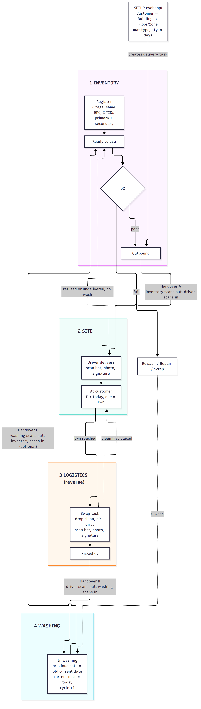
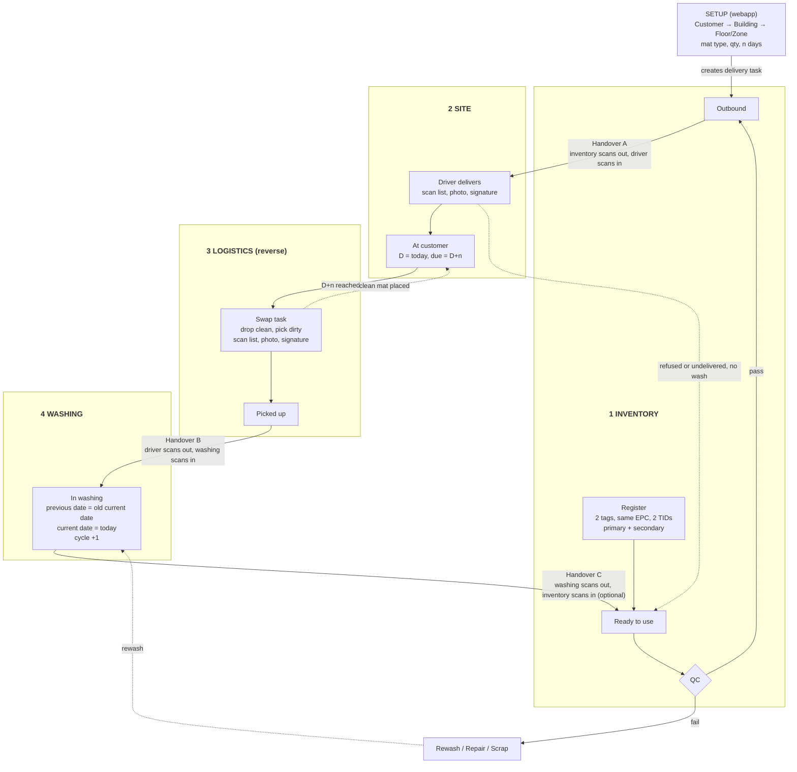

# Proposed flow

Version: 0.1.3

Proposed mat lifecycle for the RFID laundry POC. Defaults that still need client confirmation are listed under the diagram.

Mermaid source for flow.png

## Rules the diagram does not show

- A mat moves at a handover only when both sides have scanned it. A mat scanned by one side stays with the giver and is flagged.
- Wash count goes up once, at the washing manager's scan in Handover B. A re-scan adds nothing.
- Either tag heard means the mat is present. Primary and secondary matter only at registration and tag replacement.

## Defaults to confirm with the client

- Swap happens in one visit, so each customer mat needs a second one in circulation.
- Mats are a pool per type, not tied to one customer.
- One inventory location and one washing location.
- Scanners are three roles: inventory, driver, washing. A fourth is needed only if outbound is a separate person doing the scan-out in Handover A.
