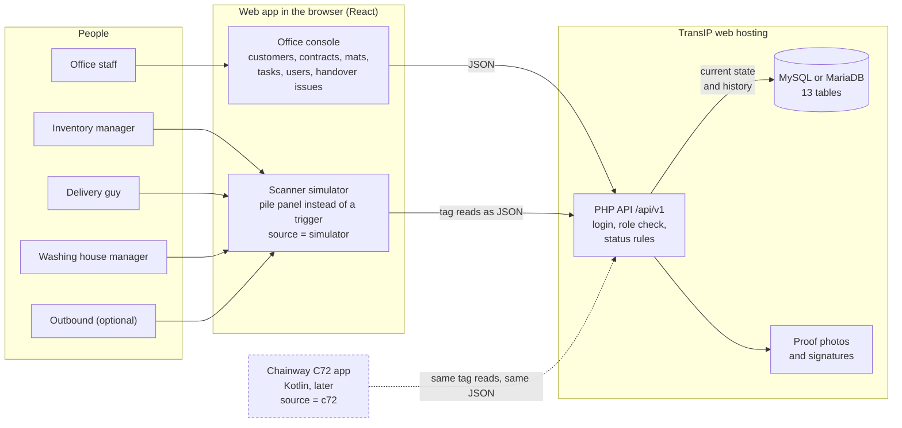
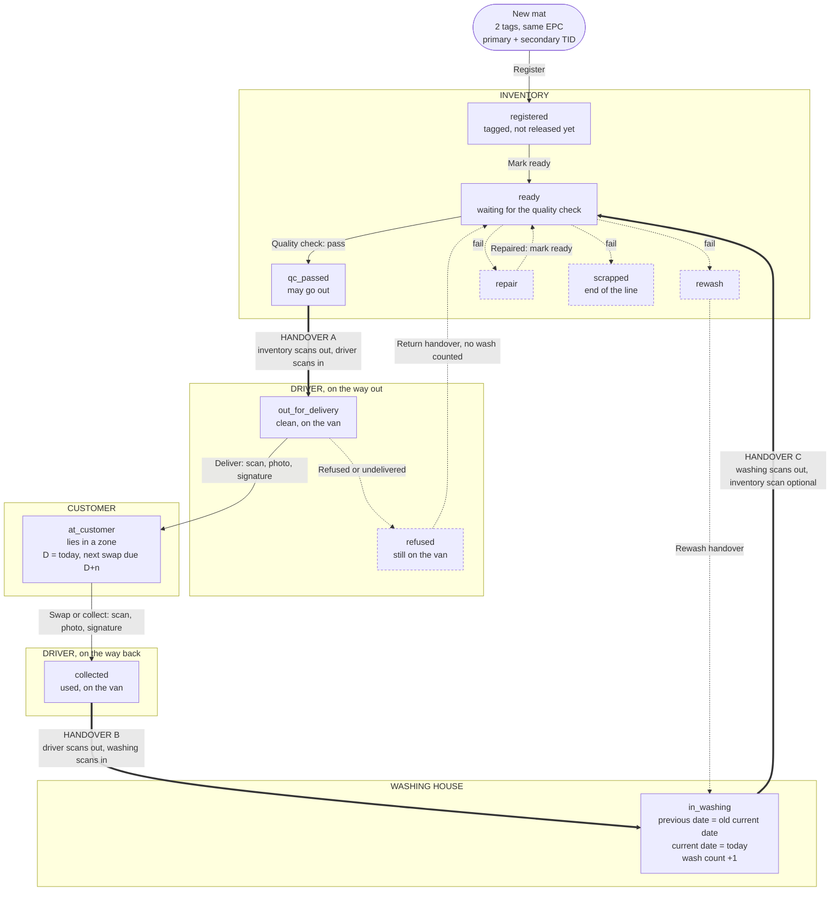
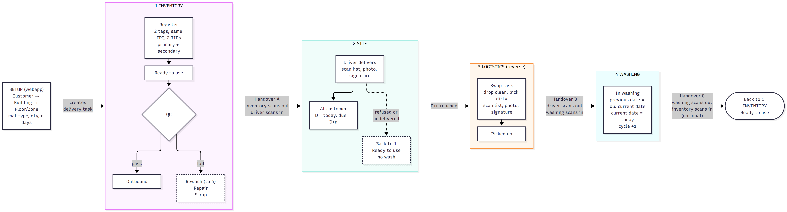
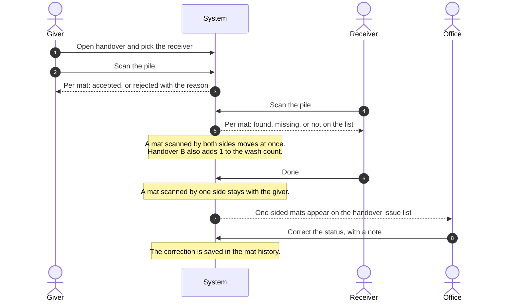

<div align="center">

<a href="https://github.com/Naveenrawat-max/laundry-poc">
  <picture>
    <source media="(prefers-color-scheme: dark)" srcset="assets/github-mark-white.svg">
    
  </picture>
</a>

# Laundry RFID POC

**Know where every mat is, who has it, and how often it has been washed.**

RFID mat tracking for Proti, a company that rents, delivers, collects and washes door mats.


### What we are going to use


**Later, for the real handheld**


[How it helps](#how-it-helps-a-laundry) ·
[System](#the-system) ·
[Mat lifecycle](#mat-lifecycle) ·
[Handover](#how-a-handover-works) ·
[Roles](#who-uses-it) ·
[Documents](#documents) ·
[Database](#load-the-database) ·
[Contributors](#contributors)

</div>

---

## What it is

Proti rents door mats to its customers, delivers and collects them with its own drivers, and washes them in its own washing house. Every mat carries two RFID tags. This system follows each mat through inventory, delivery, the customer, collection and washing.

> [!NOTE]
> **Design stage.** The scope, the flow, the system design and the database are written. No application code exists yet. The first build is a web app only: the Chainway C72 handheld is simulated by a scanner screen in the web app, and all mats are mock mats.

## How it helps a laundry

A rental laundry owns thousands of items that all look the same and are always on the move: on a shelf, in a van, at a customer, in a washing machine. Without tracking, nobody can say where one mat is, how often it has been washed, or who had it last. Proti has no software for this today.

With an RFID tag in every mat, a handheld scanner reads a whole pile at once, without unfolding or counting by hand. This system turns those reads into answers.

| Problem in a laundry | What the system does |
|---|---|
| Nobody knows where a mat is | Every mat has one current status and place: inventory, a named driver, a customer's zone, or washing |
| Counting piles by hand is slow and wrong | One scan reads the whole pile and compares it with the list that was expected: found, missing, or not on the list |
| Mats go missing between people | A mat changes hands only when both the giver and the receiver have scanned it. A mat scanned by one side stays with the giver and is flagged for the office |
| Swaps are forgotten or late | The contract sets the days between swaps. When a delivery is done, the next swap task is created with its due date |
| A customer says "we never got them" | Every delivery, swap and collection is closed with a scan, a photo and a signature |
| Nobody knows how worn a mat is | Each mat keeps its wash count and its last two wash dates. The count goes up once per wash, even if the pile is scanned twice |
| A dirty or damaged mat goes out to a customer | A mat must pass a quality check before it can be handed to a driver. A failed mat goes to rewash, repair or scrap |
| Mistakes cannot be traced | Every scan is kept in the mat's history: who, when, where, and what changed |
| The office works from memory and paper | One web app holds customers, buildings, contracts, mats, tasks and users |

It is built for growth: 40 to 50 mats now, 4,000 to 5,000 in a few years, and rented workwear later on the same platform.

## The system

Two screens in one web app, one API, one database. The scanner simulator sends exactly what the real handheld will send, so the handheld can replace it later without changing the rest.



Full design: [ARCHITECTURE.md](ARCHITECTURE.md).

## Mat lifecycle

Every box is a status a mat can have. The frames show where the mat is. Thick arrows are the three handovers, where both sides scan. Dashed boxes and arrows are side paths.



The short version of this picture, as shown to the client:

<div align="center">



</div>

## How a handover works

The same steps apply to every handover. A mat moves only when both sides have scanned it.



Scanning the same pile again changes nothing. The wash count cannot go up twice for one handover.

## The main rules

| Rule | Why |
|---|---|
| A mat moves at a handover only when both sides have scanned it | Nobody can pass on a mat the other side never received |
| The wash count goes up once per wash | A second scan of the same pile must not count as a second wash |
| Either tag heard means the mat is present | A mat has two tags so that one damaged tag does not make it disappear |
| A stop is closed only with a scan, a photo and a signature | Proof for every delivery, swap and collection |
| A mat must pass the quality check before it goes out | No damaged mat reaches a customer |
| The database refuses impossible states | A mat cannot be "at customer" without a zone, or "out for delivery" without a driver |
| The office can correct any status, but only with a note | Every correction is traceable |

## Who uses it

One login per person. The role decides what that person sees and what a scan may change.

| Role | Works with | Does |
|---|---|---|
| **Office** | Web console | Customers, contracts, mats, tasks, users, handover issues |
| **Inventory manager** | Scanner | Registers mats, marks them ready, checks quality, hands them to the driver |
| **Delivery guy** | Scanner | Delivers, swaps and collects at the customer, with photo and signature |
| **Washing house manager** | Scanner | Receives used mats, hands washed mats back |
| **Outbound** (optional) | Scanner | Only scans mats out to the driver |

The full table of who sees what is in [ARCHITECTURE.md](ARCHITECTURE.md#users-and-what-they-see).

## Documents

| File | What it holds |
|---|---|
| [POC.md](POC.md) | Scope of the proof of concept |
| [FEATURES.md](FEATURES.md) | Feature list per role, and what the client told us |
| [FLOW.md](FLOW.md) | The mat lifecycle as a diagram |
| [ARCHITECTURE.md](ARCHITECTURE.md) | System design: hosting, roles, data model, API, scanner simulator, security |
| [db/schema.sql](db/schema.sql) | Database schema, 13 tables |
| [db/seed.sql](db/seed.sql) | Mock data: 40 mats, 2 customers, 2 draft contracts |
| [docs/superpowers/plans/2026-10-12-backend-api.md](docs/superpowers/plans/2026-10-12-backend-api.md) | Implementation plan for the backend API, plan 1 of 3 |

Start with POC.md, then ARCHITECTURE.md.

## Load the database

Create an empty database, then load the schema and the mock data, in that order:

```bash
mysql -u USER -p DBNAME < db/schema.sql
mysql -u USER -p DBNAME < db/seed.sql
```

Both files run unchanged on MySQL 8.0.16+ and MariaDB 10.4+. At TransIP the same two files can be imported through phpMyAdmin.

> [!IMPORTANT]
> The seed creates no users, because a password must not sit in a file. See "First login" in [ARCHITECTURE.md](ARCHITECTURE.md#first-login).

> [!TIP]
> Every mock tag id starts with `4D4F434B` ("MOCK" in hex), so mock mats can be removed before real mats are registered.

## Versions

Each document carries its own version at the top. Every change bumps the version and is one commit.

## Contributors

<table>
  <tr>
    <td align="center">
      <a href="https://github.com/Naveenrawat-max">
        <br>
        <sub><b>Naveen Singh Rawat</b></sub>
      </a>
    </td>
  </tr>
</table>
