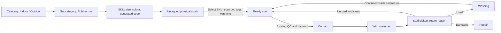

# SKU stock and mat registration

From [[00 Index]], use this guide to create product stock, map individual mats and interpret their counts. The fixed data and API choices are recorded in [[_meta/decisions/003-sku-stock-and-tag-mapping]]. Customers have no portal access; staff records returns.

1. In office setup, create a category such as Indoor or Outdoor, then a subcategory such as Rubber mat. These are the only two category levels.
2. Create a SKU under that subcategory with width and height in centimetres, colour and an integer initial quantity. The server generates a unique `MAT-` plus ULID code. Initial quantity means physical mats owned but not yet tagged. For another delivery of the same variant, use **Add stock**, entering the quantity received; do not recreate the variant.
3. In registration, explicitly select a subcategory and SKU before scanning. Scanning and **Map** require complete SKU details and positive untagged stock. Scan the two original EPC/TID pairs for one physical mat, then choose **Map**. The first tag's EPC becomes the common EPC automatically. A successful transaction creates one ready mat and consumes exactly one untagged unit. Changing the selection clears pending scans; successful mapping keeps the SKU selected for the next mat.
4. Create delivery and pickup orders through [[docs/office-orders]]. Newly mapped mats are immediately ready; existing order QC and dispatch checks still apply. Physical movements change status/location counts, not the untagged quantity. Reservations exclude mats from ready availability.
5. For a pickup, choose **Used / routine exchange**, **Unused and clean**, or **Damaged**, with an optional note. Used returns require a washing recipient and become `in_washing` on receipt; unused clean returns become `ready` at inventory; damaged returns become `repair` at inventory. Existing washing confirmation returns washed mats to inventory. Legacy contract collections retain their routine used-return flow.

Registration currently uses the existing simulator. Backend mapping stores the two-tag identity; it does not prove or perform physical RFID rewriting. There is no manual common-EPC choice or separate rewrite dialog.

## Read the counts

For a new SKU containing ten untagged mats:

| Action | Untagged | Ready | With customer | Active owned total |
|---|---:|---:|---:|---:|
| Create SKU with quantity 10 | 10 | 0 | 0 | 10 |
| Map one mat | 9 | 1 | 0 | 10 |
| Deliver that mat | 9 | 0 | 1 | 10 |
| Receive five more untagged mats | 14 | 0 | 1 | 15 |

The catalog separates ready, reserved, on-van, customer, washing, repair, scrapped and total counts. `total_quantity = untagged_quantity + tagged_quantity - scrapped_quantity`. Tagged includes all physical mat records; scrapped mats remain in history but leave active owned stock. Reserved overlaps status/location counts, so do not add every displayed column together. Ready excludes order reservations and pending/open handover scans. Catalog polling can lag another device by eight seconds; server locks govern stock changes.

Stock receipts are additive and have no receipt ledger or idempotency key. After an uncertain network outcome, check the current quantity before retrying to avoid adding the same stock twice. Product SKU code and each mat's unique asset identity remain separate.

## Implementation and validation status

The authoritative data and API contracts are summarized in [[_meta/decisions/003-sku-stock-and-tag-mapping]]. Regression coverage was written but not run. Scoped source review does not establish release readiness.

The local SKU migration was applied. Do not run demo seeders against an existing installation to recreate old stock.

Parent-reported static checks passed: PHP syntax for changed PHP and test files, TypeScript `--noEmit`, focused `git diff --check`, and a frontend build from `site/` using `node node_modules/vite/bin/vite.js build`. The build retains its 705.81 kB chunk warning above 500 kB. The global npm shim cannot find `npm-cli.js`; the direct local Vite build succeeded without repairing that unrelated installation.

No tests were run, as requested. Behavioral, concurrency, browser and hardware checks remain deferred; static checks do not establish those outcomes. Earlier passing results in [[docs/office-orders]] predate these SKU changes. The [[_code/00 Code map]] has not been regenerated: the vaultify helper is unavailable in the checked locations. This workflow diagram provides a focused view of stock transitions, not an updated source dependency map.
